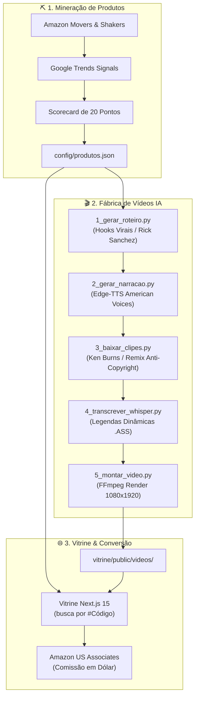

# 🇺🇸 Dollar Factory — US Affiliate & AI Video Automation Engine

<div align="center">


<p align="center">
  <strong>Sistema modular e automatizado para vendas em dólar no mercado dos EUA através de Afiliados Amazon US / TikTok Shop, combinando mineração de dados, pipeline de vídeo curto com IA e vitrine própria de alta conversão.</strong>
</p>

[Visão Geral](#-visão-geral) • [Arquitetura](#-arquitetura-do-ecossistema) • [Catálogo #01-#10](#-catálogo-de-produtos-campeões) • [Como Executar](#-como-executar-localmente) • [Roadmap](#-roadmap--próximos-passos)

---

</div>

## 📌 Visão Geral

O **Dollar Factory** foi concebido para resolver o maior gargalo de quem quer faturar em dólar a partir do Brasil: **escalar produção de conteúdo viral para audiência americana sem gastar com anúncios ou equipamentos caros**.

### ✨ Pilares do Projeto
1. **Fator 5x de Conversão:** Recebimento direto em moeda forte via ACH (Wise/Payoneer). Cada comissão de \$15-\$25 rende R$ 75-130 líquidos.
2. **Mineração Baseada em Dados:** Scorecard automatizado que avalia produtos com base em *Movers & Shakers* da Amazon US e tendências de busca do Google US.
3. **Fábrica Autônoma de Vídeos:** Geração de vídeos verticais 9:16 (1080x1920) com narração neural nativa dos EUA, legendas dinâmicas estilo CapCut, badges de urgência e sound design.
4. **Vitrine Própria Otimizada:** Storefront Next.js 15 ultra-rápido com busca instantânea por código `#XX`, player de vídeo embedado e rastreamento de cliques com conformidade FTC.

---

## 🏗️ Arquitetura do Ecossistema

O repositório é 100% desacoplado em 4 módulos independentes:

```
dollar-factory/
├── 🌐 vitrine/                  # Storefront em Next.js 15 + Tailwind CSS v4 (Deploy Vercel)
│   ├── app/                     # App Router (/ e /p/[id] com SSG)
│   ├── components/              # SearchBar, ProductGrid, VideoModal, OutboundButton
│   └── public/videos/           # Vídeos sincronizados da fábrica
│
├── ⛏️ mineracao-produtos/       # Engine de descoberta e validação Amazon US
│   ├── 1_puxar_movers_shakers.py # Scraper de tendências
│   ├── 2_validar_trend.py       # Validação de volume de busca Google US
│   └── 3_scorecard.py           # Matriz de 20 pontos de conversão
│
├── 🎬 fabrica-videos/           # Pipeline de geração de vídeos curtos verticais (1080x1920)
│   ├── config/                  # produtos.json (catálogo) e vozes.json (Edge-TTS)
│   ├── scripts/                 # Roteiro -> Narração -> Clipes -> Legendas -> FFmpeg
│   ├── assets/                  # Overlays (Rick Sanchez), trilhas e efeitos sonoros
│   └── run_pipeline.py          # Orquestrador CLI unificado
│
├── 💼 contas/                   # Guias operacionais para o mercado americano
│   └── guia_operacional_us.md   # Setup ACH Wise, W-8BEN e aquecimento de contas
│
├── 📋 PLAN.md                   # Decisões estratégicas de negócio e regras da Fase 1 vs 2
├── 📋 TASKS.md                  # Quadro Kanban padronizado de tarefas
└── 🤖 .github/copilot-instructions.md # Diretrizes técnicas para desenvolvimento com IA
```

### 🔄 Fluxo de Dados



---

## 🏆 Catálogo de Produtos Campeões (Aprovados)

Estes 10 produtos passaram pelo funil de 20 pontos de impulso e apelo visual:

| Código | Produto | Nicho | Preço US$ | Avaliações | Status do Vídeo |
| :---: | :--- | :--- | :---: | :---: | :---: |
| **`#01`** | **Electric Spin Scrubber** | Home & Cleaning | \$34.99 | 14.8k (4.7⭐) | ✅ Piloto Pronto |
| **`#02`** | **Reusable Pet Hair Roller** | Pet Must-Haves | \$24.95 | 168.4k (4.8⭐) | ✅ Piloto Pronto |
| **`#03`** | **14-in-1 Veggie Chopper** | Kitchen Hacks | \$26.99 | 92.3k (4.6⭐) | ⏳ Em Renderização |
| **`#04`** | **2-in-1 Air Fryer Oil Mister** | Kitchen Hacks | \$15.99 | 31.4k (4.8⭐) | ⏳ Backlog |
| **`#05`** | **Pull-Out Under Sink Rack** | Home & Cleaning | \$28.99 | 48.9k (4.7⭐) | ⏳ Backlog |
| **`#06`** | **Car Vent Cleaning Gel** | Car & Everyday | \$14.99 | 76.2k (4.5⭐) | ⏳ Backlog |
| **`#07`** | **Rotary Cheese Grater** | Kitchen Hacks | \$25.99 | 53.1k (4.7⭐) | ⏳ Backlog |
| **`#08`** | **Magnetic Motion Cabinet Lights** | Home & Cleaning | \$29.99 | 39.5k (4.6⭐) | ⏳ Backlog |
| **`#09`** | **Electric Sweater Defuzzer** | Home & Cleaning | \$19.99 | 112.0k (4.7⭐) | ⏳ Backlog |
| **`#10`** | **Muddy Dog Paw Washer** | Pet Must-Haves | \$16.99 | 64.3k (4.6⭐) | ⏳ Backlog |

---

## 🚀 Como Executar Localmente

### Pré-requisitos
- **Node.js** >= 18.x
- **Python** >= 3.10
- **uv** (Gerenciador ultrarrápido para Python): `winget install astral-sh.uv`
- **FFmpeg**: Configurado nas variáveis de ambiente (`PATH`)

---

### 1. Subir a Vitrine Next.js

```bash
cd vitrine
npm install
npm run dev
```
Acesse em: `http://localhost:3000` (ou porta informada no terminal).

**Destaques da Vitrine:**
- 🔍 Busca instantânea por `#Código` (ex.: `#01`, `#02`).
- 📱 Design 100% Mobile-First voltado para tráfego do TikTok e Instagram Reels.
- ⚡ Renderização estática instantânea (`generateStaticParams`).
- 🛡️ Conformidade total com regras da FTC e Amazon Associates.

---

### 2. Executar a Mineração de Novos Produtos

```bash
cd mineracao-produtos

# 1. Puxa itens em ascensão da Amazon US
uv run --no-project python 1_puxar_movers_shakers.py

# 2. Cruza com sinais de busca do Google US
uv run --no-project python 2_validar_trend.py

# 3. Aplica o scorecard e gera produtos_aprovados.csv
uv run --no-project python 3_scorecard.py
```

---

### 3. Gerar Vídeos com IA (Fábrica de Vídeos)

Para renderizar um vídeo completo (vertical 1080x1920 com legendas `.ass`, áudio neural e badges):

```bash
cd fabrica-videos

# Gera para o Produto #01 (versão v1):
uv run --no-project --with edge-tts python run_pipeline.py --id 01 --version v1

# Gera para o Produto #02:
uv run --no-project --with edge-tts python run_pipeline.py --id 02 --version v1
```

O vídeo final é gravado em `fabrica-videos/output/` e automaticamente copiado para `vitrine/public/videos/`.

---

## 🎯 Próximos Passos (Sprint Atual)

- [ ] **Fábrica Pro 2.0 (Persona Rick Sanchez):** Roteiros sarcásticos e irreverentes, voz rápida estilizada e sticker/overlay animado (`assets/rick/rick_portal.png`).
- [ ] **Sound Design:** Remoção de silêncios mortos (`silenceremove`), transições *whoosh* e efeito *ding* no preço.
- [ ] **Lote Completo de Vídeos:** Renderização dos produtos `#03` ao `#10`.
- [ ] **Deploy Vercel:** Publicação da vitrine com domínio próprio.

---

## ⚖️ Conformidade Legal & FTC

> **Aviso de Afiliado (FTC Disclosure):**
> *As an Amazon Associate, we earn from qualifying purchases at no additional cost to the buyer. All prices, ratings, and stock availability are accurate at the time of scraping and are subject to change on Amazon.com.*

---

<div align="center">
  <sub>Dollar Factory Engine • Desenvolvido para operações de escala internacional.</sub>
</div>
